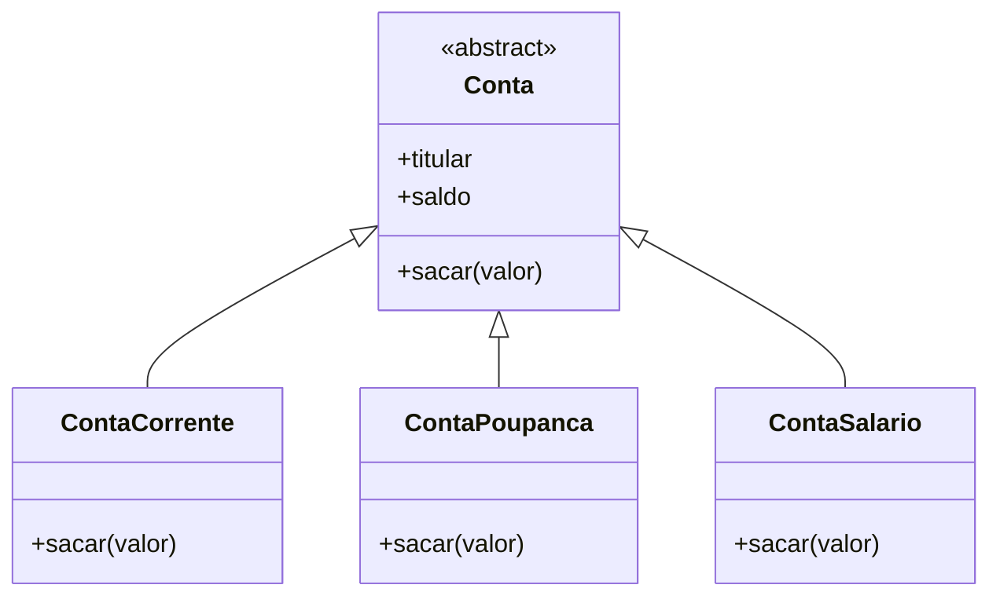

# Sprint 6 - Sistema de Contas Bancárias

## Sobre o projeto

Sistema feito em Python para praticar programação orientada a objetos, usando classes, herança, encapsulamento e polimorfismo.

## Diagrama de classes



## Funcionamento

A classe `Conta` é abstrata. As outras três classes herdam dela porque são tipos de contas bancárias. Foi usada herança para reaproveitar os atributos e métodos comuns.

O método `sacar()` demonstra o polimorfismo. Na conta corrente, o saque tem uma taxa de R$ 2,00. Nas outras contas, não há taxa.

O programa também utiliza `__init__`, `__str__`, `__repr__` e `super()`.

## Validações

O `@property` impede que o titular fique vazio ou que o saldo seja negativo.

Os métodos de saque verificam se o valor é maior que zero e se existe saldo suficiente. Entradas inválidas são tratadas com `try/except`.

## Testes

Foram criadas 10 contas para testar o sistema.

Exemplo de saída:

```text
Conta Corrente - Ana - Saldo: R$ 1000.00
Conta Poupança - Bruno - Saldo: R$ 1500.00
Conta Salário - Carla - Saldo: R$ 2000.00

DEMONSTRAÇÃO DE POLIMORFISMO
ContaCorrente: Conta Corrente - Ana - Saldo: R$ 898.00
ContaPoupanca: Conta Poupança - Bruno - Saldo: R$ 1400.00
ContaSalario: Conta Salário - Carla - Saldo: R$ 1900.00

TESTE DE ENTRADA INVÁLIDA
Erro: Titular inválido
```

## Como executar

```bash
python entregavel6.py
```